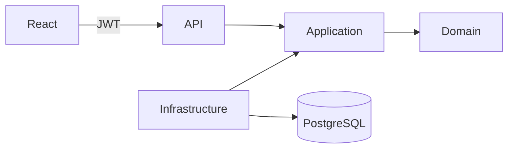

# AlunoApi: Arquitetura

> **Status:** Etapa 0 concluída · **Atualizado em:** 2026-11-10
> Este documento descreve a arquitetura atual. Os motivos das escolhas
> estão nos [ADRs](adr/README.md); o que ainda será feito está no [roadmap](roadmap.md).

## Escopo
- Login com JWT
- Cadastro, edição, consulta e inativação de aluno
- Vínculo N:N entre alunos e responsáveis

## Visão geral
Clean Architecture em monólito, com um único Bounded Context
([ADR-0001](adr/0001-clean-architecture-monolito.md)).

| Camada | Responsabilidade |
|---|---|
| Domain | Entidades, Value Objects, regras de negócio |
| Application | Casos de uso, DTOs, validação (FluentValidation) |
| Infrastructure | EF Core, migrations, proteção de CPF |
| Api | Controllers, autenticação JWT, Swagger |

Estrutura de pastas: [ADR-0002](adr/0002-estrutura-de-pastas.md).

## Domínio
- `Aluno` e `Responsavel` ligados por `AlunoResponsavel`
- `Documento` (Value Object): CPF validado; RG para aluno menor de idade
- Aluno menor de 18 anos exige ao menos 1 responsável
- Matrícula no formato `AAAA` + sequência ([ADR-0005](adr/0005-matricula-por-sequence.md))
- Inativação por `status`, sem exclusão física ([ADR-0006](adr/0006-inativacao-logica.md))

## Segurança
- Autenticação JWT (Bearer), senhas com BCrypt ([ADR-0003](adr/0003-autenticacao-jwt.md))
- CPF protegido em duas colunas: AES-GCM (exibição mascarada) e HMAC-SHA256
  (busca e unicidade) ([ADR-0004](adr/0004-protecao-de-cpf.md))
- Sem PII em logs
- Dados 100% fictícios (LGPD)

## Stack
- **Back:** .NET 10, ASP.NET Core, EF Core, PostgreSQL
- **Front:** React, TypeScript, Vite, TanStack Query
- **Erros:** `ProblemDetails` (RFC 7807)

## Estratégia de testes
- Unitários no domínio (xUnit, Moq, FluentAssertions), com TDD
- Integração com Testcontainers
- Arquitetura com NetArchTest